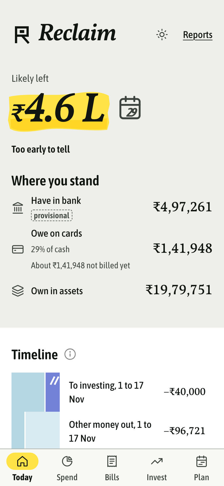
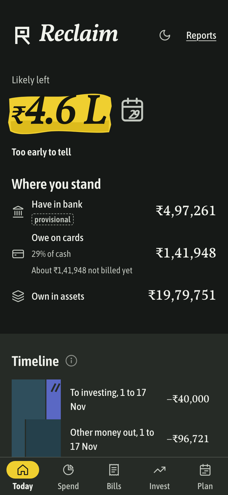
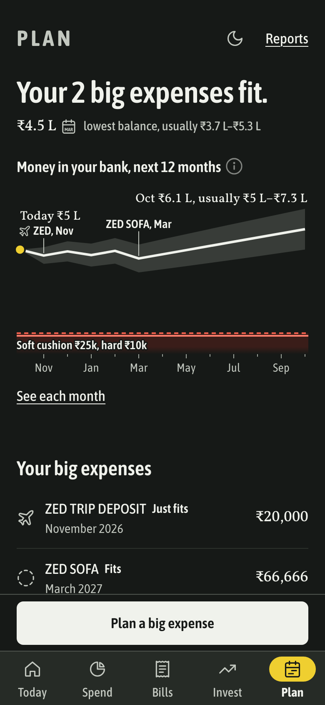
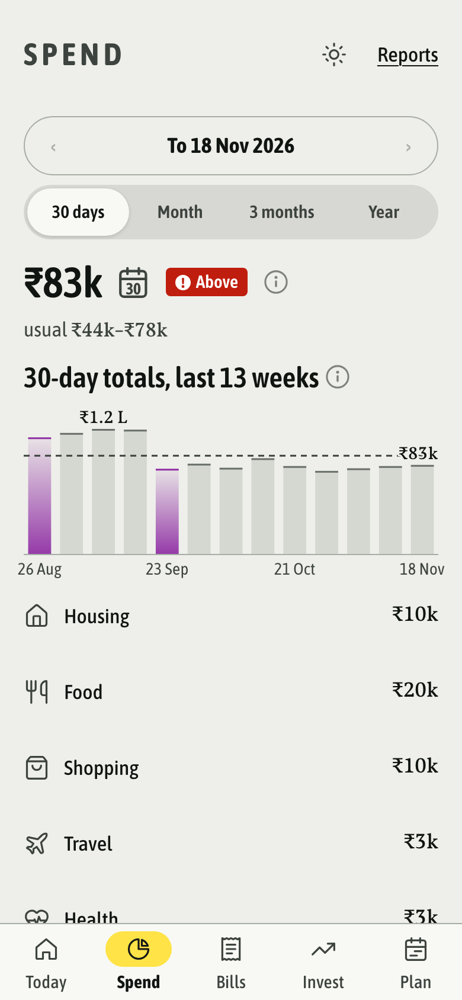
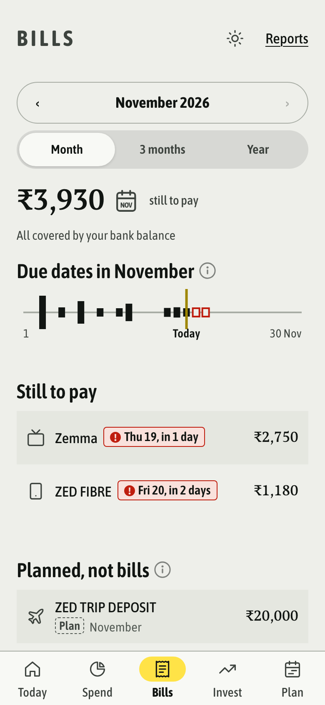
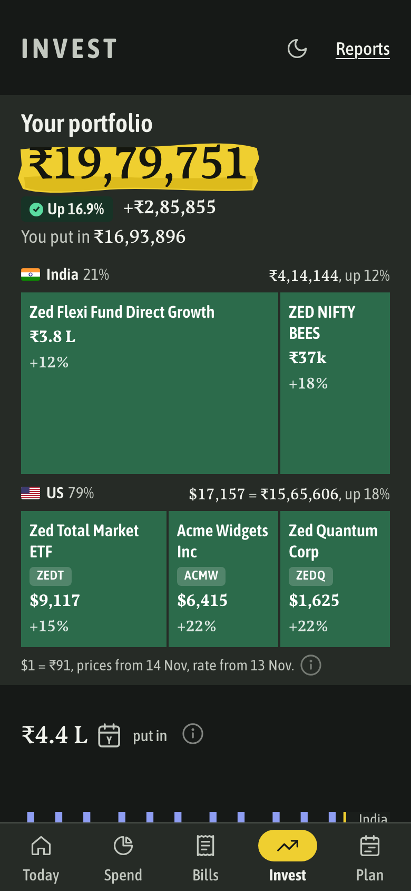
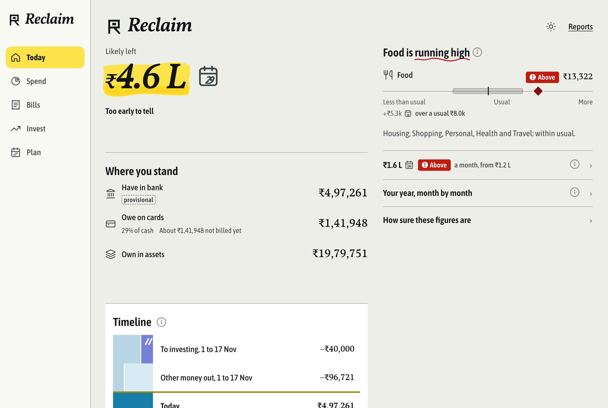

<h1 align="center">Reclaim</h1>

<p align="center"><b>How much is likely left before payday, worked out from your own bank statements, on a box you own.</b></p>

<p align="center">
  <a href="LICENSE"></a>
  
  
  
</p>

<p align="center">
  
  
  
</p>

Reclaim is a privacy-first personal finance app for one person. Your bank SMS, statements and mail go to a small server you control, a pipeline turns them into a ledger, and a mobile-first web app answers one question first: **how much will likely be left before the next salary, and what is going to take it.**

**[Try the live demo](https://tusharpandey.com/reclaim/)** (invented data, best on a phone).

This repository is the **web client** (a React PWA) and the **design record** behind it. It runs on its own with an invented demo world, so you can try every screen without any real data. The backend is in development (see below).

> Every figure in this repository and its screenshots is invented. No real account, name or amount is here.

## Why

- **Own your data.** No bank aggregator, no screen-scraping service, no analytics, no cloud. Your money data stays on a box you own, reachable only over your private network.
- **Statements are the truth.** Only a bank statement moves cash. SMS and mail are fast but provisional: they show up early and are labelled as such until a statement confirms them. Receipts and your corrections add names and items, never amounts.
- **An answer, not a dashboard.** You should not have to learn the app. The first screen is a number with a range and a sentence, not a chart wall or a settings page.

## What it does

| Page | What it answers |
|---|---|
| **Today** | Likely left before salary, as a range. Where you stand: cash in bank, owed on cards, assets. A timeline of money in and out up to payday. What is running high. |
| **Spend** | Your last 30 days of everyday spending against your usual 30 days, by group, each drawn on its own scale. A treemap of where it went and a monthly spend map. |
| **Bills** | What is still to pay this month and when, card bills from their statements, and planned expenses kept apart from bills. |
| **Invest** | Your portfolio (put in, value, gain), your year week by week, holdings by market, and targets. |
| **Plan** | Your bank balance over the next 12 months with your big expenses placed on it. Each one reads Fits, Could dip, Dips or Sell. |
| **Name payees** | Turn cryptic UPI and bank lines into names, with a likely guess to accept in one tap. |
| **Reports** | Cash flow, audit and a flatmates split, as CSV or PDF, made on the phone with no network. |
| **Sources** | How fresh each source is, and what a stale one means for the numbers. |

Built to a frozen design ("Till", then the "Tight" pass):

- **One fact per line.** Legends and method notes wait behind an (i), so the screen stays readable at a glance.
- **Words and chips, not colour alone.** Above usual, within usual and estimate are written in chips; colour never carries a status by itself.
- **No red for "could".** Red means the likely outcome is under your cushion. A possible dip reads in ink and words.
- **Light, dark and system themes**, phone first, two columns on desktop.
- **Installable PWA** whose service worker caches the app shell only. No private data is stored on the phone.
- **Strict Content Security Policy.** Fonts and icons ship in the bundle; nothing loads from a third party.
- **Works under any URL prefix.** Hash routes and relative paths, so the same build runs at `/` or `/reclaim/`.

<p align="center">
  
  
  
</p>

<p align="center">
  
</p>

## Quick start

Needs Node.js 20.19+ or 22.12+.

```sh
cd client/html
npm ci
npm run dev        # http://localhost:5171/
```

The dev server serves the invented demo data from `client/html/fake/` (a manifest, a hash-checked `snapshot-v2` file and a status file), exactly as the real box would. The demo is dated 18 November 2026, so "updated ... ago" wording reads oddly on other days. Saving a correction or a planned expense needs the backend's write API: in the demo a save fails and stays on screen with a retry, by design.

Other commands, from `client/html/`:

```sh
npm test           # unit tests (Vitest), including the client engine against the demo snapshot
npx playwright install chromium   # once
npm run e2e        # every page at phone and desktop width, on the demo data
npm run build      # type-check and build dist/ (shell only, no data in it)
npm run shots      # retake the README screenshots (with npm run dev running)
npm run contract   # regenerate types and validator from docs/contracts/snapshot-v2.schema.json
```

To point the dev server at another snapshot directory, set `RECLAIM_FIXTURE_DIR`.

## How it fits together

```
 phone / mail / statements          private network            your box
┌──────────────────────────┐                             ┌─────────────────────────┐
│ Android SMS collector    │── POST /v1/ingest ────────▶ │ ingest server           │
│ statements, mail exports │   (contracts/ingest-v1)     │ raw log + SQLite        │
└──────────────────────────┘                             │ finance pipeline        │
                                                         │  → ledger → snapshot    │
┌──────────────────────────┐   GET manifest + snapshot   │                         │
│ Reclaim web client       │ ◀────────────────────────── │ static files, no-store  │
│ (this repository)        │ ── POST corrections, plans ▶│ write API (app-write-v1)│
└──────────────────────────┘                             └─────────────────────────┘
```

The client reads only two files: `manifest.json`, which names the current snapshot and its SHA-256, and that snapshot, which it validates against a precompiled JSON Schema before showing anything. The contract is in [`docs/contracts/snapshot-v2.md`](docs/contracts/snapshot-v2.md).

## Backend: in development

Not in this repository yet. Described here so the client makes sense, not offered as a working product:

- **Ingest server.** Stdlib-only Python with SQLite. An append-only raw log is the source of truth, with idempotent upserts and per-device tokens. A new source needs no server change.
- **Finance pipeline.** Bank statements, bank SMS, mail and receipts become a double-entry ledger, then the published snapshot: forecasts with ranges, usual spend, bills, investments, plan rows. Gates refuse to publish when a statement is missing or balances do not tie.
- **Android SMS collector.** A native app that pushes new messages to the box over the private network, and saves its place only after the server commits.

## Roadmap

- Saving corrections and planned expenses to the box, live.
- More collectors: app receipts and service exports, through the same ingest contract.
- Investment holdings kept fresh, then tax views.
- A small life-events scenario engine on Plan.
- Publishing the backend once it is ready to run on someone else's box.

## Privacy stance

- Your data lives on hardware you control. Nothing is sent to a cloud, an aggregator or an analytics service.
- The client stores nothing private on the device: data is held in memory, and the service worker caches the app shell only.
- URLs may carry a page, group or month, never a name or an amount.
- Errors name a field, never a value.
- This repository, its tests and its screenshots use invented data only.

## Design record

The decisions behind the client are written up as short ADRs in [`docs/adr/`](docs/adr/), from statements as the only cash truth to hash routes. The full frozen design, its debates and reviews, and the static mocks are in [`docs/design/`](docs/design/).

## Licence

MIT, see [LICENSE](LICENSE). Bundled fonts are under the SIL Open Font License (`client/html/public/OFL-fonts.txt`). Icons are Lucide outlines (ISC). No brand logos are included; merchants get their category icon.
